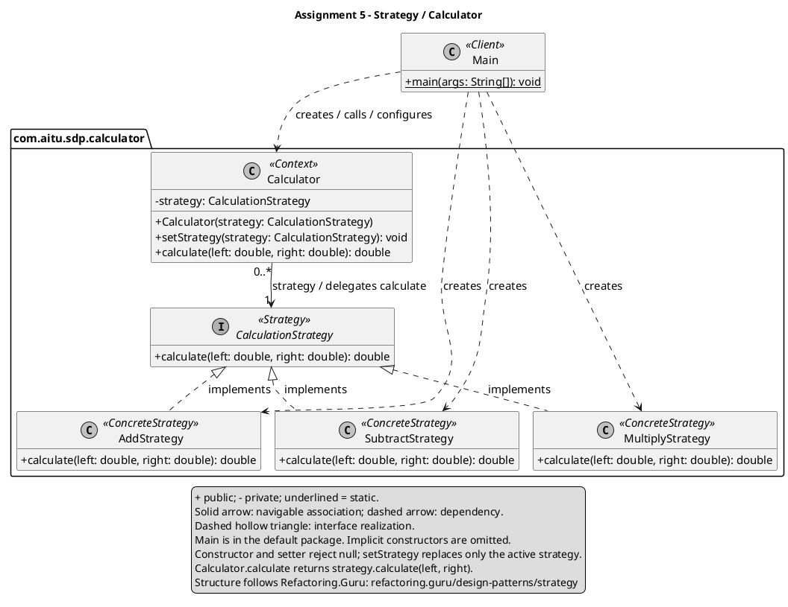

# Assignment 5 | Strategy Pattern

Astana IT University | ShP-2216 Software Design Patterns | 2026-2027  
**Student:** Sabyr Aslan | **Group:** SE-2528 | **Option B:** Calculator

## 1. Introduction

The chosen domain is a calculator. Its algorithm family consists of addition,
subtraction and multiplication of two `double` operands. Each operation implements
`CalculationStrategy.calculate(left, right)`. `Calculator` stores that interface
and delegates to it; `Main` supplies and replaces the concrete strategy [1, 2].
This removes arithmetic selection branches from the context.

The application contains six Java files. The context needs only a constructor,
`setStrategy` and `calculate`; each concrete strategy implements one method.
No menu, factory, strategy registry or external library is needed.

## 2. UML class diagram


The diagram follows the Strategy structure on Refactoring.Guru, the website listed
in the assignment [2]. It describes this implementation and is rendered locally
with PlantUML. Editable source: [class-diagram.puml](docs/class-diagram.puml).
Vector export: [class-diagram.svg](docs/class-diagram.svg).

`+` means public and `-` private; the underlined `main` is static.
The solid arrow is a navigable association: each calculator has exactly one
active strategy; one strategy may be shared by zero or more calculators.
It is not a lifetime-owning composition, because the client creates and supplies
strategies. Dashed hollow triangles mean interface realization; dashed open
arrows show the client's creation/configuration dependencies. `Main` is in the
default package; all five domain types are in `com.aitu.sdp.calculator`.
Implicit constructors and the standard-library `Objects` dependency are omitted.

<details>
<summary>PlantUML source (included for a self-contained Markdown submission)</summary>



</details>

## 3. Clean Code

### 3.1 Replace algorithm conditionals with polymorphism

```java
return strategy.calculate(left, right);
```

`Calculator.calculate` delegates through the interface. It contains no `if`,
`switch`, `instanceof` or concrete-strategy references. Adding an algorithm does
not create another context branch.

### 3.2 Use intention-revealing names

```java
calculator.setStrategy(new SubtractStrategy());
```

`SubtractStrategy`, `setStrategy`, `left` and `right` communicate the chosen
operation, replacement and operand order without numeric codes or explanations.

### 3.3 Give each class one responsibility

```java
// MultiplyStrategy.calculate(double left, double right)
return left * right;
```

The multiplication strategy performs only multiplication. It handles no output,
input or selection. `Main` demonstrates the operations; `Calculator` delegates.
Every concrete strategy method has one executable statement.

### 3.4 Keep the context algorithm-agnostic

```java
private CalculationStrategy strategy;

public Calculator(CalculationStrategy strategy) {
    this.strategy = Objects.requireNonNull(strategy, "strategy");
}
```

The private, interface-typed field and constructor injection hide the concrete
algorithm. The context never constructs a concrete strategy. Constructor and
setter reject null, so successful configuration always leaves a valid delegate.
If the setter rejects null, the old strategy remains active.

### 3.5 Extend behavior without editing existing algorithms

```java
public final class MultiplyStrategy implements CalculationStrategy {
    @Override
    public double calculate(double left, double right) {
        return left * right;
    }
}
```

The extension is demonstrated by real commits: `bfb73d7` introduced addition and
subtraction; `c5eb508` added multiplication. The extension adds one class and
changes `Main` and `sources.txt` only. `Calculator`, `CalculationStrategy`,
`AddStrategy` and `SubtractStrategy` are unchanged. The source comparison is
recorded in [extension.diff](extension.diff). Future strategies use the same steps.

## 4. Strategy vs. State

This problem selects an arithmetic algorithm, so it calls for Strategy. The client
explicitly chooses an operation; the same operands can produce 16, 8 or 48.
Strategies do not know each other or initiate transitions. State instead models
behavior that depends on an object's lifecycle state, such as a document moving
from draft to published [3]. Replacing a strategy changes the calculator's
configuration; it does not represent progress through a state machine.

## 5. Conclusion

The same `Calculator` instance performs addition, subtraction and multiplication
after two `setStrategy` calls. Running `Main` gives:

```text
Add: 12 + 4 = 16.0
Subtract: 12 - 4 = 8.0
Multiply: 12 * 4 = 48.0
```

Compiled with `--release 17 -Xlint:all -Werror`; executed on Java 17.0.16.
The optional verification harness passes 15 checks: arithmetic including negative,
zero and exactly representable fractional inputs, operand order, switching back,
context identity, null rejection and a new independent implementation.
Its source and actual output are in `docs/StrategyVerification.java` and
`docs/verification-output.txt`.

The benefit is a context that stays unchanged when algorithms are added. The cost
is one interface, three small concrete classes and delegation for operations
that would otherwise fit in a few expressions. The class count is justified here
by the assignment's requirement to demonstrate interchangeable algorithms.
The example uses standard `double` arithmetic, not exact decimal computation.

## 6. GitHub repository

[asikxz008/Assigment5-sdp-Aslan](https://github.com/asikxz008/Assigment5-sdp-Aslan)

### References

[1] Assignment #5 - Strategy Pattern, ShP-2216, Astana IT University, 2026-2027,
Sections 2-5. Supplied assignment instructions.

[2] Refactoring.Guru. [Strategy](https://refactoring.guru/design-patterns/strategy).
Structure, algorithm delegation and calculator example. Accessed 25 October 2026.

[3] Refactoring.Guru. [State](https://refactoring.guru/design-patterns/state).
Intent and lifecycle transitions. Accessed 25 October 2026.

Preparation aid: OpenAI ChatGPT/Codex assisted with the implementation example,
documentation and verification. This assistance is disclosed for transparency.
